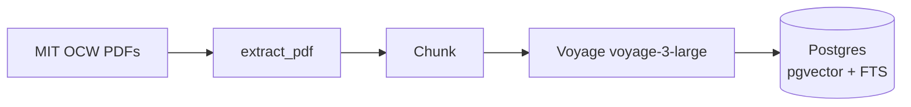
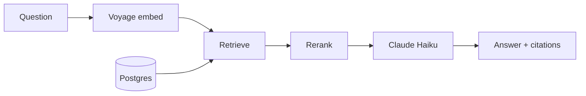

# lexgo-rag-eval

> Rigorously evaluating multi-source RAG over MIT 6.006 (Algorithms) + MIT 6.830 (Database Systems) course materials. Comparing dense / semantic-chunked / hybrid / hybrid+rerank retrieval strategies against 100 hand-curated golden Q&As.

---

## Results

Five trials each on the MIT golden file (`evals/golden/qa.jsonl`, 100 questions). Each cell is the mean of the five published rates. Accuracy is the judge's binary score. Citation precision and recall are page-level. A chunk counts when a gold page falls inside its page range. Cost per query is the mean of each trial's generate, judge, and rerank spend divided by 100.

| Pipeline | Chunking | Retrieval | Rerank | Accuracy | Page citation precision | Page recall@5 | Cost/query | P95 latency |
|---|---|---|---|---|---|---|---|---|
| P1 baseline | Fixed 512/64 | Dense (Voyage) top 10 | none | 64.1% | 37.1% | 49.7% | $0.0011 | 3.6 s |
| P2 semantic | Semantic p90, 256 to 1024 tokens | Dense top 10 | none | 64.4% | 37.8% | 48.5% | $0.0011 | 2.1 s |
| P3 hybrid | Fixed 512/64 | BM25 + dense (RRF), top 10 | none | 62.4% | 37.2% | 47.8% | $0.0011 | 2.0 s |
| P4 hybrid+rerank | Fixed 512/64 | Hybrid top 20 | Cohere Rerank 3, top 10 | 64.9% | 39.6% | 54.7% | $0.0031 | 2.3 s |

---

## System

**Ingest**



**Query**



**Ingest.** Course PDFs are extracted page by page, split into chunks, and embedded. Postgres stores the chunk text, its embedding, and a full-text index. A document whose extracted text has not changed is skipped.

**Query.** The question is embedded and matched against those chunks, by vector search or by vector search fused with full text. An optional rerank step reorders the matches. The chat model then writes an answer and cites the chunks it used. If nothing is retrieved, the answer says the question is outside the materials.

**Eval and app.** Eval sends each golden question down that query path and asks a judge whether the answer matches the gold answer. Citation precision and recall compare page spans. The demo runs the same query path and shows the answer, the citations, and the retrieved chunks. The author page edits the golden set.

---

## Reproduce

Requires Python 3.12, [uv](https://docs.astral.sh/uv/), and Postgres with pgvector for ingest and eval.

```bash
git clone https://github.com/Axle7XStriker/lexgo-rag-eval.git
cd lexgo-rag-eval

cp .env.example .env         # then fill in ANTHROPIC_API_KEY, VOYAGE_API_KEY, COHERE_API_KEY

make setup                            # uv sync — creates .venv, installs pinned deps
make corpus                           # download MIT OCW PDFs into corpus/ (idempotent, ~2 min)
make db-up                            # start local Postgres + pgvector
[PIPELINE=<p1|p2|p3|p4>] make ingest  # ingest corpus into the db
make app                              # streamlit run app.py — Demo + Author pages in the sidebar
make validate                         # lint the golden Q&A set (evals/golden/qa.jsonl)
[PIPELINE=<p1|p2|p3|p4>] make eval    # score the golden file on a pipeline
```

The Streamlit app ships two pages:

- **Demo** — RAG query UI.
- **Author** — hand-curation UI for the 100-Q&A golden set with live progress
  against the 40/25/20/10/5 distribution targets. Reads/writes
  `evals/golden/qa.jsonl` with atomic file-rewrite semantics.

`make help` lists all targets.

---

## Blog post

*Link added once the writeup is published.*

---

## Project context

Full scoping, corpus breakdown, working conventions, and schedule live in [`CLAUDE.md`](./CLAUDE.md).

---

**Author:** [Aman Bansal](https://github.com/Axle7XStriker)
